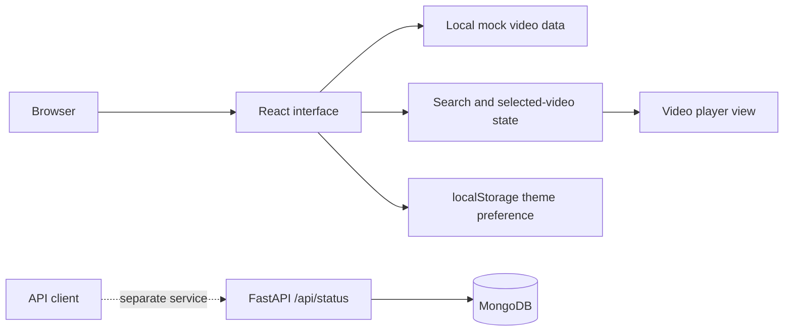

# Video Browsing UI Prototype

**A React interface for browsing and searching a sample video catalog.**

## Overview

The frontend recreates a video-browsing experience with a header, sidebar, mock video cards, and an in-app player view. Search, sidebar collapse, and a dark-mode preference are managed in the browser. The repository also includes a separate FastAPI/MongoDB status-check service; the video interface uses local mock data.

## Key features

- Browse a sample catalog of video cards.
- Search the catalog by video details.
- Open a selected video in the player view.
- Collapse the navigation sidebar and toggle a persisted dark theme.
- Run a small FastAPI status-check API backed by MongoDB.

## Tech stack

React, React Router, Tailwind CSS, JavaScript, FastAPI, Python, Motor, and MongoDB.

## Architecture and workflow



## Project structure

```text
.
├── frontend/
│   ├── src/             # React interface and sample video data
│   ├── package.json
│   └── craco.config.js
├── backend/
│   ├── server.py        # FastAPI status endpoints
│   └── requirements.txt
└── tests/
```

## Installation and execution

### Frontend

Requires Node.js and Yarn:

```bash
cd frontend
yarn install
yarn start
```

### Backend

Requires Python and MongoDB. From the repository root:

```bash
cd backend
python -m venv .venv
# Activate the environment for your shell, then:
python -m pip install -r requirements.txt
```

Set `MONGO_URL` and `DB_NAME` in `backend/.env`, then run:

```bash
uvicorn server:app --reload
```

The API exposes its status-check routes under `/api/status`.

## Author

**Gireesh Sadanand Patgar** · [GitHub](https://github.com/gireeshpatgar17)